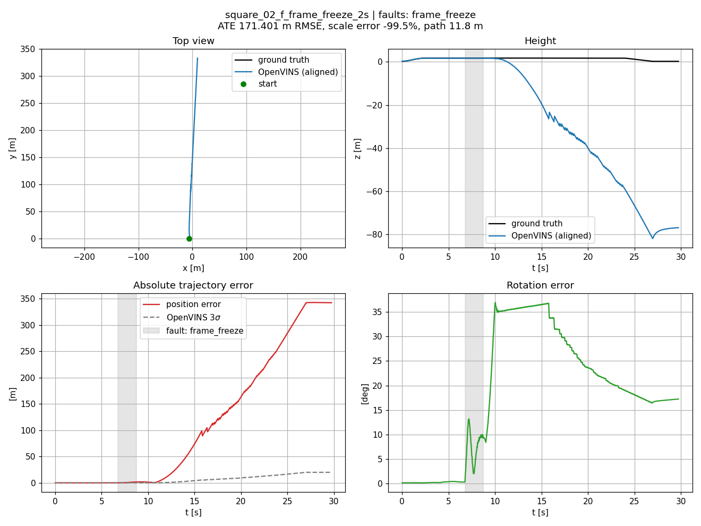
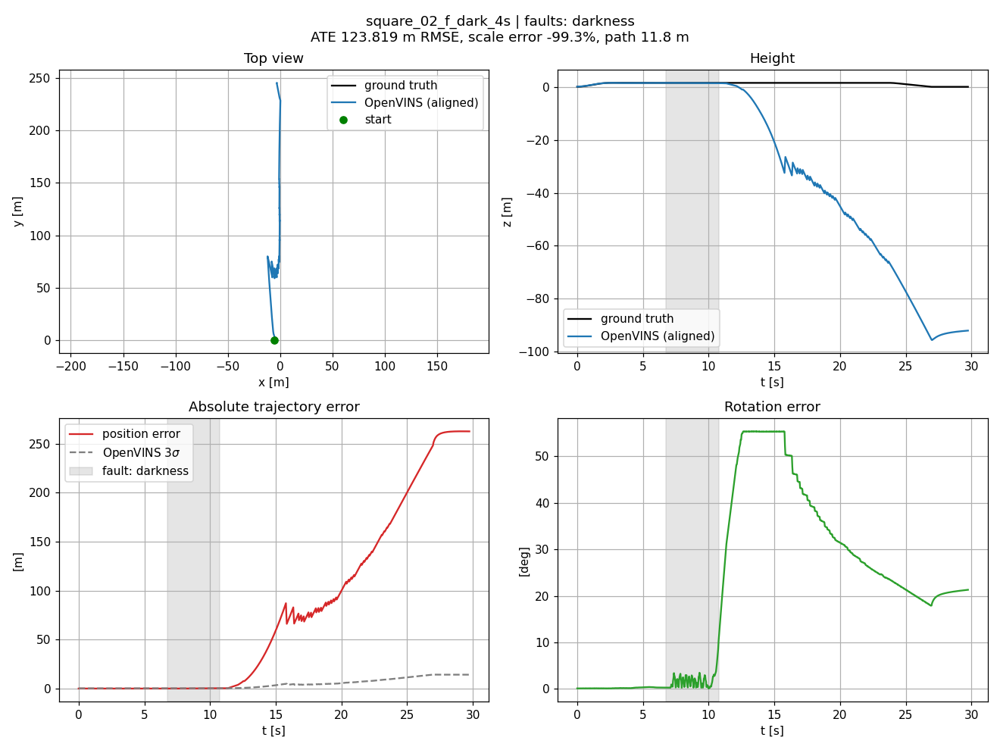

# Faults: OpenVINS on a replayed flight with injected faults

One flight (`square_02`: takeoff, 2 m square, landing; 11.8 m path) recorded as a bag and replayed once per fault through `fault_injector.py`. Same bag, same config, only the fault changes. Scenarios are in `vin_ws/src/vio_eval/faults/`; most start 10 s after arming, mid-square.

All runs are aligned on the same stretch, the first 6.8 s after OpenVINS initialises, which is before any of the mid-flight faults start. That way the error shows what happened from the fault on, and a run that diverges doesn't drag the alignment.

| Fault | ATE | Max error | Rotation | RPE (1 s) | Error at landing |
|---|---|---|---|---|---|
| none (reference) | 0.047 m | 0.074 m | 0.38 deg | 0.020 m | 0.044 m |
| IMU noise x7, 5 s | 0.050 m | 0.074 m | 0.42 deg | 0.020 m | 0.048 m |
| camera drops out, 1 s | 0.044 m | 0.074 m | 0.25 deg | 0.021 m | 0.035 m |
| IMU bias step (0.1 m/s², 0.005 rad/s) | 0.092 m | 0.150 m | 0.57 deg | 0.026 m | 0.098 m |
| camera 20 ms late, whole flight | 0.142 m | 0.486 m | 0.86 deg | 0.086 m | 0.139 m |
| motion blur 15 px, 4 s | 6.76 m | 10.0 m | 2.84 deg | 1.07 m | 10.0 m |
| darkness (15% light), 4 s | 124 m | 263 m | 28.6 deg | 14.7 m | 262 m |
| camera frozen, 2 s | 171 m | 343 m | 22.7 deg | 17.0 m | 342 m |

The shaded band on each plot is the time the fault was active.

## What it shows

- **IMU noise and a short camera dropout barely matter.** OpenVINS coasts through 1 s with no images on the IMU and picks up again.
- **A bias step and a time offset degrade it but it holds.** The 20 ms offset is the worst of the "survivable" ones: a 49 cm spike early on and roughly 3x the error overall. Time offset calibration is off on purpose.
- **Frozen, dark and blurred frames break it.** Three different ways:
  - **Frozen camera.** The images stop changing, so OpenVINS thinks the drone has stopped and applies zero-velocity updates (about 51 of them, the whole freeze) while it's actually flying. Its state is wrong by the time real images come back, and it runs away.
  - **Darkness.** It limps through the 4 s, then the rotation error jumps to 55 degrees the moment the lights come back and the position runs away. Cause not yet confirmed.
  - **Blur.** It drifts the wrong way during the blur and ends up about 10 m off, but doesn't keep running away.
- **OpenVINS doesn't notice.** In the runs that diverge, its own 3-sigma stays at 5-20 m while the real error passes 250 m. It keeps publishing poses with confidence it shouldn't have.

Full numbers in the `*_metrics.json` files.
