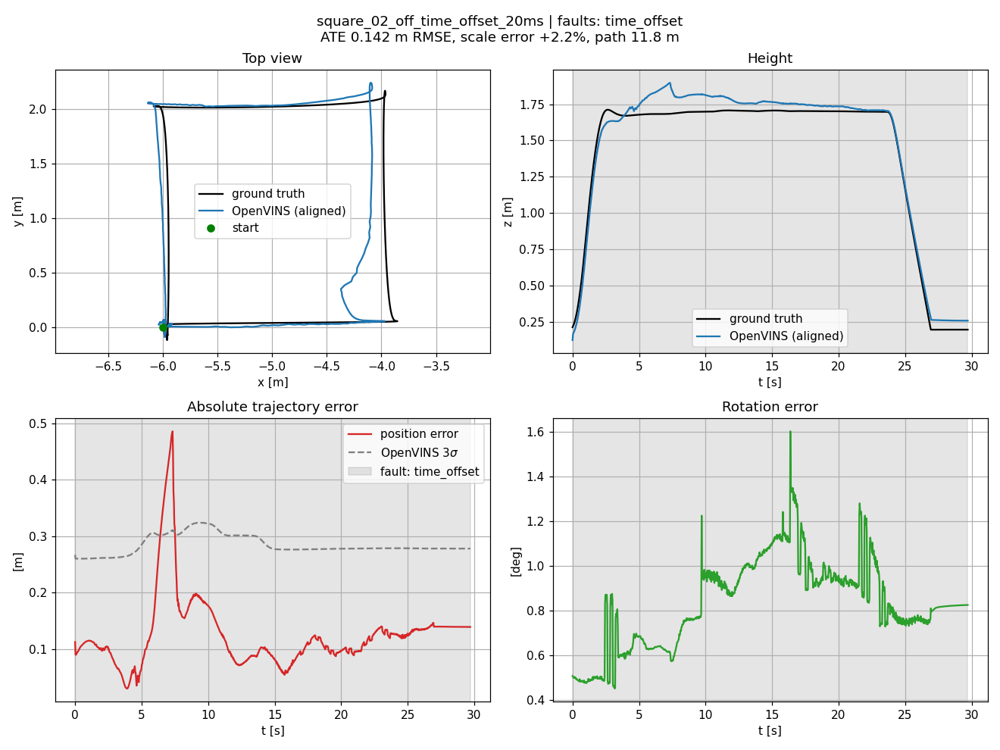

# Faults: OpenVINS on a replayed flight with injected faults

One flight (`square_02`: takeoff, 2 m square, landing; 11.8 m path) replayed once per fault. Each fault is written into a copy of the bag first (`make_faulted_bag.py`), then the copy is replayed, so every run is exactly repeatable. Scenarios are in `vin_ws/src/vio_eval/faults/`; most start 10 s after arming, mid-square.

All runs are aligned on the same stretch, the first 6.8 s after OpenVINS initialises, before any mid-flight fault starts.

| Fault | ATE | Max error | Rotation | RPE (1 s) | Error at landing |
|---|---|---|---|---|---|
| none (reference) | 0.047 m | 0.074 m | 0.38 deg | 0.020 m | 0.044 m |
| IMU noise x7, 5 s | 0.050 m | 0.074 m | 0.42 deg | 0.020 m | 0.048 m |
| camera drops out, 1 s | 0.044 m | 0.074 m | 0.25 deg | 0.021 m | 0.035 m |
| darkness (15% light), 4 s | 0.041 m | 0.074 m | 0.26 deg | 0.020 m | 0.040 m |
| motion blur 15 px, 4 s | 0.061 m | 0.105 m | 0.38 deg | 0.023 m | 0.094 m |
| IMU bias step (0.1 m/s², 0.005 rad/s) | 0.092 m | 0.150 m | 0.57 deg | 0.026 m | 0.098 m |
| camera 20 ms late, whole flight | 0.142 m | 0.486 m | 0.86 deg | 0.086 m | 0.139 m |
| camera frozen, 2 s | 34.9 m | 70.8 m | 6.37 deg | 3.59 m | 69.4 m |

## What it shows

- **Most faults it shrugs off.** IMU noise, a 1 s dropout and 4 s of darkness barely move the error. Blur costs a few centimetres. In this warehouse even a dark image keeps enough corners to track.
- **A bias step and a time offset hurt more.** The 20 ms offset is the worst of these: a 49 cm spike early on and roughly 3x the error overall. Time offset calibration is off on purpose.
- **A frozen camera breaks it.** The images stop changing, so OpenVINS thinks the drone has stopped and applies zero-velocity updates (69 of them, the whole freeze) while it's actually flying. By the time real images come back its state is wrong, and it runs away by tens of metres.
- **OpenVINS doesn't notice.** In the frozen run its own 3-sigma stays at a few metres while the real error passes 70 m.

## A correction

A first round of these tests injected the faults live, with a node between the bag and OpenVINS. Darkness and blur then looked catastrophic (124 m and 7 m). That was the injector, not the faults: processing every image held up the IMU messages behind it, and OpenVINS fell over on the scrambled timing. Written into the bag beforehand, the same darkness and blur are harmless. The frozen camera fails either way, through the zero-velocity updates, but less badly than the live run suggested (171 m then).

Full numbers in the `*_metrics.json` files.
