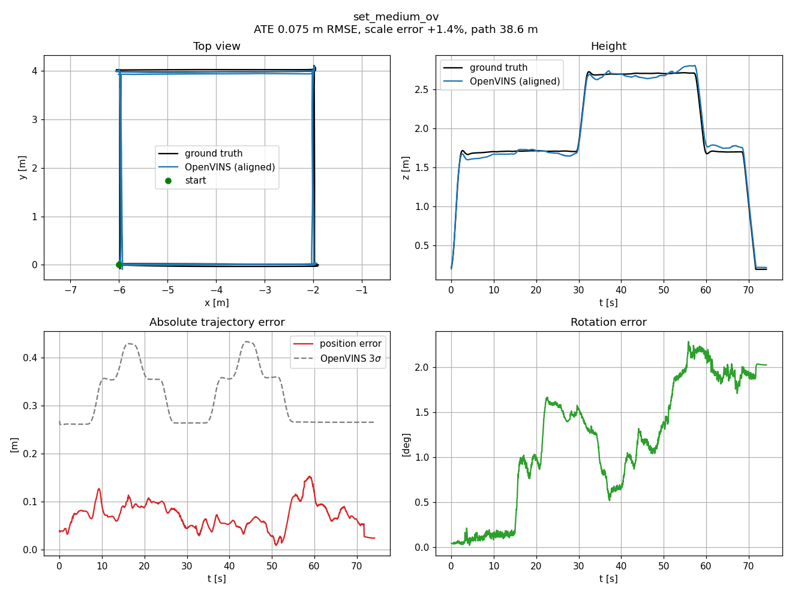
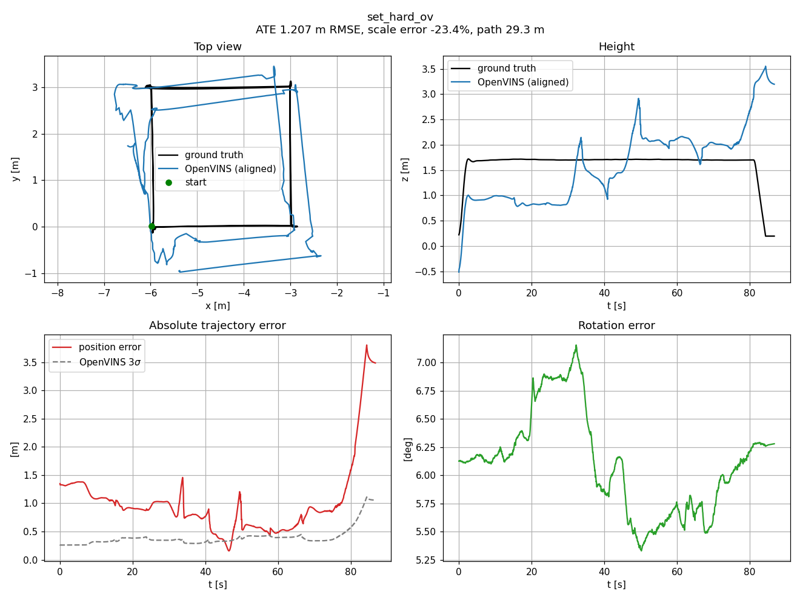

# Flight set: OpenVINS on four flights

Four flights from `vio_flight_patterns.py`, each recorded once as a bag with all sensors and replayed into OpenVINS. Clean sensors, no faults. Scored from initialisation to disarm.

| Flight | What it flies | Path | ATE | Max | Rotation | Scale | Error at landing |
|---|---|---|---|---|---|---|---|
| easy | 2 m square, heading fixed | 11.9 m | 0.022 m | 0.044 m | 0.18 deg | +0.4% | 0.027 m |
| medium | 4 m square at 1.5 m/s, 2 loops, second 1 m higher | 38.6 m | 0.075 m | 0.152 m | 1.38 deg | +1.4% | 0.024 m |
| weak | 20 s hover, then 3 m out and back at 0.25 m/s | 9.3 m | 0.025 m | 0.052 m | 0.79 deg | +1.6% | 0.035 m |
| hard | 3 m square up to 1.7 m/s, nose turning 90 deg at each corner, 2 loops | 29.3 m | 1.21 m | 3.80 m | 6.12 deg | -23% | 3.49 m |

- **Medium** is a longer flight with a height change. The error roughly triples but it still lands within a few centimetres.
- **Weak motion** was expected to be hard for mono VIO and wasn't. The takeoff gives enough acceleration to fix the scale, and with perfect sensors a minute isn't long enough to drift. It should matter more once realistic noise is added.
- **Hard** breaks it. The rotation error is already about 6 degrees at the start and the height is off from the first second, so it looks like OpenVINS initialised badly on this flight, before any turning. The fast turns then add jumps in height. Not yet looked into.

Full numbers in the `*_metrics.json` files.
